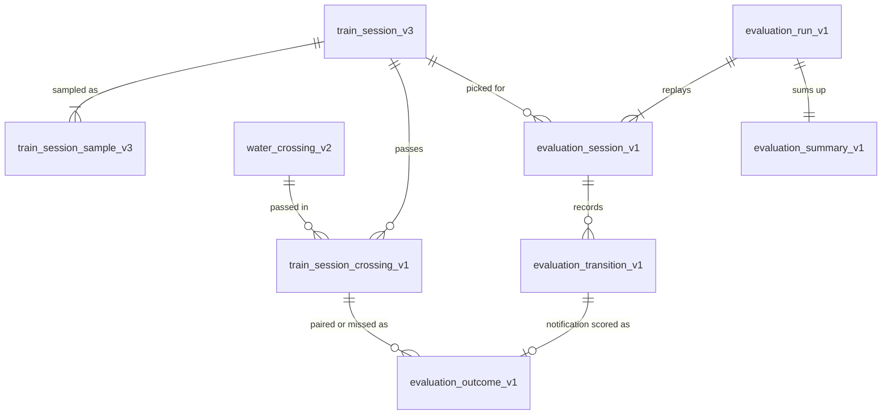

# Current Slice: Evaluation framework with associated Crow Flies predictor improvement

### Target

I have some larger ideas for how to come up with a good predictor (see [notes](2026-10-03-observational-predictor.md)), but for now I want to:
* improve the predictor in a minimal way
* measure that improvement robustly

I'd like to go from a very simple Crow Flies predictor I have now, which effectively just shows distance to nearby crossings, to one that takes into account current speed and average direction, and predicts when a crossing will be passed in next N minutes. Effectively a "Light Cone" approach.

The evaluation method should be focussed on being well-understood and robust, even if it does not simulate all aspects of reality. More complete extensions can be reserved for later slices.

### Straw Man

#### What is a Prediction?

We have to become a lot crisper than previously on what a prediction means. Right now the display just shows a radar style view which isn't really making a prediction and is instead just a map of nearby crossings. 

My suggestion is that, for each crossing, we need to have a state-machine, something like:

States:
* `OutOfReach`: this is maybe an implicit state that any crossing sits in, if it is just in the pointset data, and isn't reachable at all
* `CandidatePass`: this is when it becomes nearby enough to be considered as a possible crossing
* `PredictedPass`: this is when we expect we will actually pass by this crossing in the next N minutes
* `ActualPass`: we just actually passed the crossing

Transitions:
* `OutOfReach` <-> `CandidatePass`: a crossing can oscillate in and out of being a candidate
* `OutOfReach` -> `PredictedPass` or `CandidatePass` -> `PredictedPass`: this is us making a prediction, and this transition should lead to a notification of some kind to the user
* `PredictedPass` -> `CandidatePass` or `PredictedPass` -> `OutOfReach`: this counts as a failed prediction
* `PredictedPass` -> `ActualPass`: a successful prediction.
  * A crossing stays in the `ActualPass` state until we've gotten some distance away from it to avoid re-notifying repeatedly.
  * In general, the state transitions should probably have some sort of debouncing or hysteresis to avoid frequent flips in and out of states.
* `ActualPass` -> `PredictedPass`: it's always possible we can pass somewhere multiple times, so this counts as a new prediction
* `ActualPass` -> `CandidatePass`: still within reach but not currently predicted
* `ActualPass` -> `OutOfReach`: it's now some distance from us and we don't even think it is a candidate

In this framework, depending on how clever the predictor is, we may be able to display a crossing but still label it as OutOfReach. This could be, for example, if we decide it is technically close by but we are not going to reach it because it's not on our current track. However, any predictor that can do that is likely out of scope of this slice.

#### Moving from a CrowFlies to a LightCone Predictor

The cleverness of the predictor we do in this slice should be limited to using a current-speed/direction + Light-cone approach i.e. predict what we will reach based on where we will pass by based on current velocity vector.

This can start with a low-level of cleverness about current speed/direction (i.e. just literal current speed) and then start building up an overall speed/direction based on an average over last few fixes and/or on speed reported by the GPS device.

I suspect on Web we could benefit from the cleverness of the GPS baked into the phone, as it's probably doing something clever, but I'd prefer not to use that and instead do it ourselves, as then we have consistent performance across platforms. I am thinking here of some sort of Kalman-filter or similar; however that's possibly over-kill for this slice.

#### Evaluation method and modelling approach

The method should be informed by the [research](2026-08-01-evaluation.md) done previously.

We should drive a predictor based on fake train data as if it was receiving it live, and then assess it based on ground truth of what was actually passed.

This should use the motis data we have recorded i.e. we should replay `train_session_sample_v2`, with some caveats. The intent of the previous slice was to record a full weeks worth of train data for Germany, but unfortunately part-way through we lost `realtime` feeds [without realising it](completed-slices.md#caveat-realtime-stops-partway-through-the-capture). 

Some [analysis](../notebooks/evaluation/explore1.py) shows which `trip_id`s on which `polled_date`s have > 90% coverage of realtime datapoints. It's about 40,000 trips clustered around 2026-10-18 and 2026-10-19. We should implement this 90% coverage filter by re-doing the derivation of `train_session_sample_v2` so that it contains a `realtime` column and extend `train_session_v2` to have a `realtime_pct` which allows us to apply the filter i.e. we'd only include sessions whose coverage was >= 90%.

The underlying data may require some further cleaning to remove any other anomalies that exist. As long as this doesn't massively affect coverage then we can adopt a bias to discard invalid data instead of trying to fix it. This may have to happen at the session level i.e. we may have to discard whole sessions if some percentage of it (e.g. 10%) is invalid.

We will also want to do a version of `session_crossing_v3` but for train sessions, `train_session_crossing_v1`. We'll need this to assess Precision i.e. what the predictor said it would reach soon, vs what it did.

To measure recall, one approach we could take is to have an "oracle" predictor to compare against: we could take the actual crossings the train passed and works backwards to when a perfect predictor would have said it was coming. This allows us to assemble a stream of crossing state updates that would be the best score. This may also flush out if there are some constraints or ambiguities in our system which means even an oracle with perfect foreknowledge can't get a perfect score on precision and recall.

Hopefully these `realtime` samples will be enough samples to give a good statistical evaluation, but if not, we can relax our `realtime` constraint and instead use all of the sessions we have.

We don't need to model gps accuracy in this slice, but it can be an extension we attempt if things go well. The sorts of thing we could do here would be to use the real recorded sessions from being on a train to build a distribution of gps accuracy and sample from that model. This could then be layered on top of the train position as an error signal to perturb it.

#### Visualising in Crux App on Web and M5

The CrowFlies and LightCone Predictors will need to make explicit the states of each crossing as they see them.

These only have to be minimally supported in the Crux Apps e.g. showing a different shape for each crossing either in the Canvas view, or as some ASCII-art on M5. They don't have to be updated to manifest a notification from the internal predictor as a user-visible notification.

#### Style of development and how to record evaluations

I generally prefer a Walking Skeleton approach and I'd like to apply that here, alongside some of the themes of explainability from [recent investigations](2026-10-18-demonstrable-behaviour.md). This means that I'd like to have a very basic evaluation in place, starting with a small amount of samples, say `1000`. This allows us to go through an inspectable series of steps that show if the method is working before extending to longer runs.

This also means we don't have to implement the LightCone predictor at start. That can come after we have a proper evaluation of CrowFlies in place.

The output of evaluation should live in `gold` as tables recording things like predictor name + parameters, evaluation method, sample sizes, and random seeds, as well as output. So, we probably want to have a mix of tables describing the evaluation run as well actual results. These can be summary distributions.

However, I probably also want the data in detail about what the predictor predicted and when, perhaps recorded as an `evaluation_session`, also in `gold`. This can perhaps record the state transitions over time. This can be inspected for debugging to check everything is working, and also to replay edge-cases or to visualise where there are hotspots of prediction failures. If we are wanting to replay over time, rerun may be a good choice, but a notebook is also fine.

Overall this means that Tasks should be broken down into major stages with each stage delivering some aspect of
* derivation of data for sessions
* driving predictor
* evaluating it
* visualising it

### The measure

A **notification** is a crossing's entry into `PredictedPass`. It claims that the train passes the
crossing within the horizon N.

A **hit** is a notification paired with a ground-truth pass of its crossing within N after it. Each
pass pairs with one notification at most, the earliest in the N before it. A **false alarm** is a
notification paired with no pass, which includes a repeat for a pass already paired. A **miss** is a
pass paired with no notification.

- **Precision** is hits over notifications.
- **Recall** is hits over the passes in the sessions replayed.
- **False alarms per hour** is false alarms over the hours replayed.
- **Lead time** runs from a hit's notification to its pass, and is reported as a distribution.

Transitions into the other states are recorded and not scored. The predictor's own `ActualPass` is
among them, since the ground truth decides whether a pass happened. Timeliness enters through the
lead-time distribution alone. The early and late classes of
[the research](2026-08-01-evaluation.md#outcome-classification) wait until that distribution has
been seen.

### The datasets

The slice adds three silver datasets and five gold ones. Gold partitions by `run_date` and then
`run_id`, as [medallion.md](medallion.md#partitioning) lays out evaluation results.

- `train_session_v3` and `train_session_sample_v3` are the v2 datasets with `realtime_pct` and
  `realtime` added.
- `train_session_crossing_v1` holds each pass of a train session, one per visit within the match
  radius.
- `evaluation_run_v1` holds a run's predictor and settings, method, filter, sample size, seed, and
  input versions.
- `evaluation_session_v1` holds each session a run replays, with its hours, so a session with no
  transitions still counts.
- `evaluation_transition_v1` holds each transition. A crossing whose state stays the same between
  two samples writes nothing.
- `evaluation_outcome_v1` holds each notification as a hit or a false alarm, and each miss.
- `evaluation_summary_v1` holds a run's measures, with its counts of sessions, passes, and
  notifications.

### Decisions

Decisions taken before starting, as each changes what gets built, confirmed on 2026-11-04.

- **The evaluation is a chain of named steps in Rust, which Python runs and one CLI composes.** Each
  step takes and returns tables that map to Arrow, with geometry as GeoArrow. A notebook runs any
  step through a Python extension, for quick iteration and inspection. The CLI runs every step in
  order, or any one alone, against silver and the gold earlier steps wrote. Its full run is itself a
  step the extension exposes, so a notebook runs what the CLI runs. This applies the named steps of
  [the demonstrable-behaviour assessment](2026-10-18-demonstrable-behaviour.md#a-derivation-reports-its-steps).
  It beats a binary alone, whose steps a notebook cannot inspect, and a notebook alone, which puts a
  derivation in Python.
- **Precision counts each notification.** Every entry into `PredictedPass` is one prediction,
  scored as a hit or a false alarm. A predictor that flickers pays for each flicker, as a rider
  would. Recall counts each ground-truth pass once. This beats one outcome per (session, crossing)
  pair, taken from its first notification, as
  [the research](2026-08-01-evaluation.md#unit-of-counting) proposes. That leaves every repeat
  unscored.
- **One state machine, the tracker, lives in `predictor`.** A predictor judges which state each
  crossing it reports belongs in. The tracker turns those judgements into transitions, applying the
  legal transitions and the debouncing. The oracle, CrowFlies, and LightCone therefore share one set
  of transition rules. This beats a state machine per predictor, whose rules can drift apart.
- **The first run replays 1000 sessions.** They are picked at random, under a recorded seed, from
  the sessions with `realtime_pct` ≥ 90. A session is the unit a predictor replays. It beats 1000
  sample rows, which hold a handful of sessions, and 1000 passes, which fix recall's denominator
  rather than the sessions.

#### Consequences elsewhere

- **`train_session_v2` and `train_session_sample_v2` give way to v3.** Any change to a declaration
  makes a new version, an added column included. `motis_ingest` writes v3 alone, and the v2 row
  types go.
- **The matching's session loses its device.** `session_crossings::matching::Session` holds a
  `device_id`, which a train session lacks. The device moves to the rows that `silver.rs` builds.
- **Gold holds datasets of rows for the first time.** [medallion.md](medallion.md#partitioning)
  partitions evaluation results by run, and nothing writes them yet. `medallion`'s writers, its
  `Query`, and `medallion-py` each gain gold.

#### Rejected / deferred

- **A Kalman filter on the velocity.** Deferred, since the Straw Man judges it more than this slice
  needs. A train sample carries no noise to filter, so it waits on a model of GPS error.
- **A model of GPS error.** Deferred: the Straw Man's extension for a slice that goes well. It
  perturbs each train position with accuracy sampled from the recorded sessions.
- **The phone's own speed and heading.** Rejected, so that every platform runs one velocity
  estimate.
- **Interpolating each pass's instant along the path**, as
  [the research](2026-08-01-evaluation.md#ground-truth) proposes. Deferred:
  `train_session_crossing_v1` takes the nearest sample, as `session_crossing_v3` does. It comes back
  once samples prove to lie more than twice the match radius apart, where a pass between two goes
  unmatched.
- **Rerun as the viewer of a run.** Deferred, since the notebook draws a session's transitions over
  time. It comes back once watching one replay at speed is wanted.

#### Open questions

- **Does a run started from Python write gold?** The tasks assume not: the CLI records runs, and a
  notebook runs the steps to inspect them. A yes adds a gold writer to `medallion-py`.
- **Do the steps take `medallion-model`'s gold rows?** The tasks keep the store out of the steps'
  crate, as the assessment's
  [rebuild timings](2026-10-18-demonstrable-behaviour.md#where-the-extension-lives) advise. The
  `evaluate` crate then maps each step's rows to a gold dataset's. Taking the store in costs the
  extension a rebuild time nobody has measured.
- **Which float does a replay run in?** The tasks assume `f32`, as both apps run, rather than the
  store's `f64`. Between samples 10 s apart, `f32`'s 0.42 m of latitude is under 1% of the distance
  a moving train covers.
- **Does a crossing reach `ActualPass` without a prediction?** The Straw Man's transitions leave out
  `CandidatePass` → `ActualPass` and `OutOfReach` → `ActualPass`. The answer sets the tracker's
  legal transitions, and what an app shows after a pass nobody predicted.
- **Which N does the first run use?** [target.md](target.md) notifies a minute ahead, and the
  research's lead-time window ends at 120 s. CrowFlies' sweep settles N for the runs after it.
- **Which leg sets a dwelling sample's `realtime`?** A sample waiting at a stop sits between the leg
  arriving and the leg departing. The answer moves `realtime_pct` for trips with long dwells.
- **Where does the cleaning rule apply?** `motis::train_sessions` already drops a trip for each of
  four reasons, and logs each count. Marking invalid rows for `select` to filter is the alternative,
  and adds a v3 column. The answer waits on the anomaly task.
- **How does a comparison state its uncertainty?** One way is an interval on each predictor's rates.
  The other is a bootstrap over sessions of the difference between two predictors on the same
  sessions. The answer shapes `summarise`'s output, and what "robustly" means in the Target.
- **Which predictor do the apps run once the slice ends?** LightCone where it beats CrowFlies, or
  CrowFlies until a later slice. The answer sets the predictor and settings that `platform-core`
  holds.

### Tasks

#### Refactors / extensions

- [ ] Run `just outdated`, and upgrade what it lists that this slice touches, each in a commit of
      its own.
- [ ] Move the device out of `session_crossings::matching::Session`, since a train session has none.

#### Phase 1: the sessions and their passes

The evaluation replays these datasets, and their counts show whether the filter, `realtime_pct` ≥
90, leaves enough sessions.

- [ ] Look for anomalies in `train_session_sample_v2` with the user, in
      `notebooks/evaluation/explore1.py`, before v3 is declared.
- [ ] Decide, from the anomalies found, which samples or sessions the cleaning rule discards.
- [ ] Add `realtime` to `TrainSessionSampleRowV3` and `realtime_pct` to `TrainSessionRowV3`, written
      by `motis::train_sessions` in place of v2.
- [ ] Apply the cleaning rule in `motis::train_sessions`. A rule that marks rows instead lands with
      `select`.
- [ ] Re-derive with `just silver-motis-ingest`. Check that about 40,000 sessions reach
      `realtime_pct` ≥ 90, as `explore1.py` counted per day and trip.
- [ ] Remove `TrainSessionRowV2`, `TrainSessionSampleRowV2`, and their snapshots, and delete the v2
      files from the local store.
- [ ] Add `TrainSessionCrossingRowV1`, and derive `train_session_crossing_v1` in `session_crossings`
      through the matching `session_crossing_v3` uses.
- [ ] If reading every train sample at once runs out of memory, match one date at a time.
- [ ] Measure in `explore1.py` the spacing of samples in the sessions the filter keeps, against the
      250 m match radius.

#### Phase 2: the skeleton, run with the oracle

The oracle's score is known before it runs: perfect, short of what the data or the rules forbid. A
run of it tests every new part, from the tracker to gold, before a real predictor sits behind them.

- [ ] Add `CrossingState`, `Transition`, and `Tracker` to `predictor`, with a test per transition the
      Straw Man lists, from constructed judgements.
- [ ] Create the `evaluation` crate, free of the store, with the step `select`: sessions picked at
      random under a seed.
- [ ] Add the step `replay` to `evaluation`, feeding a session's times and positions alone through a
      predictor and the `Tracker`.
- [ ] Add the oracle to `evaluation`: a predictor that reads a session's ground-truth passes, and
      predicts each N ahead.
- [ ] Add the step `score` to `evaluation`, pairing notifications with passes as
      [The measure](#the-measure) defines.
- [ ] Add the step `summarise` to `evaluation`: the measures, with the counts of sessions, passes,
      and notifications.
- [ ] Add the `evaluation-py` extension, exposing each step and the full run, with geometry crossing
      as GeoArrow.
- [ ] Build `notebooks/evaluation/predictions.py` with the user, running the oracle's steps on a few
      sessions and drawing each.
- [ ] Extend `medallion` to gold datasets of rows, partitioned `run_date=<date>/run_id=<id>`, each run
      written once.
- [ ] Register gold datasets by name in `medallion`'s `Query`, and add `query_gold` to
      `medallion-py`.
- [ ] Define the gold datasets that [The datasets](#the-datasets) names, in `medallion-model`.
- [ ] Add the `evaluate` crate, whose CLI runs every step in order or any one alone, and a
      `just evaluate` recipe.
- [ ] Run the oracle over 1000 sessions with `just evaluate`.
- [ ] Trace each shortfall from a perfect score in `predictions.py`, through `query_gold`, and record
      its cause under Investigation.

#### Phase 3: CrowFlies through the skeleton

CrowFlies is the baseline that later predictors are measured against, and the first predictor the
tracker meets that can be wrong.

- [ ] Have `CrowFlies` judge each crossing: `CandidatePass` within its radius, `PredictedPass` while
      it arrives within N, `ActualPass` within a pass radius.
- [ ] Run CrowFlies over the oracle's sessions and seed with `just evaluate`.
- [ ] Sweep N, the pass radius, and the debouncing. Choose CrowFlies' settings from recall plotted
      against false alarms per hour.
- [ ] Draw CrowFlies' false alarms and misses on a map in `predictions.py` with the user, and one
      session's transitions over time.

#### Phase 4: LightCone

LightCone is the improvement the Target asks for, measured against CrowFlies on the same sessions.

- [ ] Add `LightCone` to `predictor`: a velocity from the last two samples, and `PredictedPass`
      inside the cone it reaches within N.
- [ ] Run LightCone over the same sessions and seed, sweeping the cone's angle, and compare its best
      settings with CrowFlies'.
- [ ] Average the velocity over the last few samples, as a setting of `LightCone`, and run it again.
- [ ] Draw LightCone's cone at each sample in `predictions.py` with the user, where it beats
      CrowFlies and where it loses.
- [ ] Run both predictors over every session the filter keeps. If the uncertainty stays too wide,
      widen the filter to every session.

#### Phase 5: states in the apps

The apps come last, since they show the states of the predictor the evaluation chooses.

- [ ] Hold the `Tracker` in `platform-core`'s model, around the predictor the evaluation chose, and
      expose each crossing's state.
- [ ] Carry each crossing's state in `web-core`'s `Predicted`, and draw one shape per state in
      `lookout-predictor.js`.
- [ ] Prefix each crossing's line in `m5-core`'s `panel.rs` with one character per state, within 13
      characters.
- [ ] Build with `just wasm` and `just m5plus-build`. Hand over `just m5plus-flash`, and a look at
      `/kiosk`.

#### Wrap-up

- [ ] Fold what held of `2026-08-01-evaluation.md` into `docs/evaluation.md`, repoint the links to
      it, and delete it.
- [ ] Add `train_session_crossing_v1` and the gold datasets to the derivation graph in
      `docs/architecture.md`.
- [ ] Describe gold datasets of rows in the gold sections of `docs/medallion.md`.
- [ ] Describe `realtime` and `realtime_pct` in `crates/motis/README.md`, and train sessions in
      `crates/session_crossings/README.md`.
- [ ] Rewrite `predictor`'s README for the tracker and LightCone, and `platform-core`'s for the
      states it exposes.
- [ ] Show the states in the picture in `docs/web.md`, and on the panel in
      `crates/platform/m5/README.md`.
- [ ] Write the READMEs of `evaluation`, `evaluate`, and `evaluation-py`.
- [ ] Name the v3 datasets in the help of `silver-motis-ingest`, and `train_session_crossing_v1` in
      that of `silver-session-crossings`.
- [ ] Remove `explore1.py`, whose question `realtime_pct` answers, with the answer in the removing
      commit.
- [ ] Run `just test-no-docker`, and hand over `just test`.
